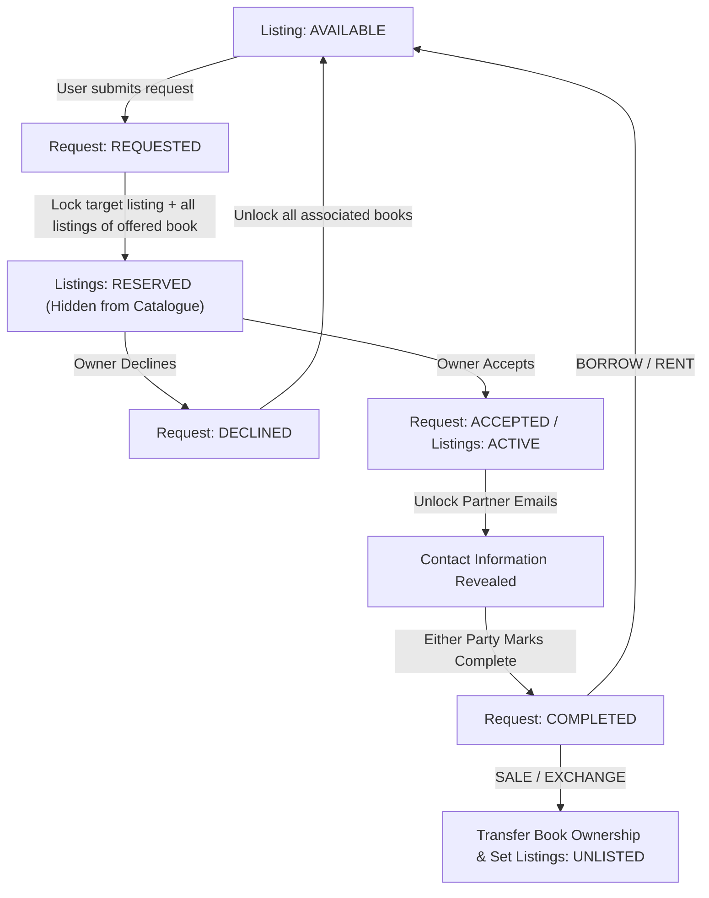

# BookLoop Lite

BookLoop Lite is a full-stack peer-to-peer book circulation platform that enables members to borrow, rent, buy, or swap physical books within a local community. 
Built as a lightweight, zero-infrastructure companion to the enterprise BookLoop platform (Java, Spring Boot, PostgreSQL, Docker), this implementation preserves the core domain modeling, state-machine workflows, and concurrency safeguards of the full system while running on a streamlined Node.js, Express, and React stack.
* **Web Application:** [https://bookloop-lite.vercel.app](https://bookloop-lite.vercel.app)
* **Backend API:** [https://bookloop-lite-backend.onrender.com](https://bookloop-lite-backend.onrender.com)

> **Note for Reviewers:** The backend runs on Render's free tier and spins down after 15 minutes of inactivity. If the initial login or registration request takes 30–50 seconds, the server is waking up from a cold start—subsequent requests will respond immediately. Demo credentials are listed below.
---

## System Architecture

The application uses a decoupled client-server architecture deployed across Vercel (static edge delivery) and Render (persistent Node.js runtime), communicating via REST over HTTPS with cross-origin HTTP-only cookie authentication.

```mermaid
flowchart LR
    subgraph Client ["Frontend (Vercel CDN)"]
        UI["React 18 + Vite SPA"]
        AuthCtx["AuthContext & Route Guards"]
        Axios["Axios Client (withCredentials)"]
        UI --> AuthCtx --> Axios
    end

    subgraph Server ["Backend API (Render Web Service)"]
        CORS["CORS & Reverse Proxy Middleware"]
        JWT["JWT Cookie Verification"]
        Domain["Domain & Locking Engine"]
        CORS --> JWT --> Domain
    end

    subgraph Storage ["Persistence Layer"]
        LowDB[("lowdb (data.json)")]
    end

    Axios -- "HTTPS / JSON + HttpOnly Cookie" --> CORS
    Domain -- "Serialized Request Processing" --> LowDB
```



---

## Transaction & Locking Lifecycle

Every request follows a deterministic state machine that governs catalogue visibility, asset locking, and ownership transfer:



---

## Core Functionality

* **Book and Listing Decoupling:** Separates physical inventory (`Books`) from market availability (`Listings`). A user adds a book to their personal shelf once and can publish multiple independent transaction offers (e.g., Borrow, Rent, Sale, or Exchange) for that single item.
* **Four Transaction Models with Type-Specific Validation:**
  * **Borrow:** Free temporary loan; enforces zero pricing.
  * **Rent:** Paid temporary loan; requires both a rental fee and a maximum duration in days.
  * **Sale:** Permanent ownership transfer; requires a purchase price.
  * **Exchange:** Two-sided book swap; requires selecting an eligible, unencumbered book from the requester's own shelf.
* **Mutual Resource Locking (Double-Spend Prevention):** Initiating a request immediately locks the target listing. For two-sided exchanges, the backend reserves every available listing for both the requested book and the offered book before accepting another request so neither asset can be promised to another user simultaneously.
* **Privacy-Gated Contact Disclosure:** Participant email addresses remain redacted throughout the negotiation phase (`REQUESTED`) and are revealed only after the owner explicitly accepts the transaction (`ACCEPTED`).
* **Automated Ownership Transfer:** Completing a `SALE` or `EXCHANGE` transaction atomically reassigns book ownership (`ownerId`) to the recipient and retires permanent listings, whereas `BORROW` and `RENT` completions return the listing to the public catalogue.


### Key Engineering Decisions

1. **Two-Sided Exchange Integrity:** An exchange request cannot be submitted without a valid `offeredBookId` owned by the requester. The backend enforces ownership (`403 Forbidden` if unowned) and locks every active listing tied to both books. If a book is listed simultaneously for `SALE` and `EXCHANGE`, accepting an exchange automatically removes the `SALE` listing from the catalogue to prevent conflicting commitments.
2. **Cross-Origin Session Security:** Authentication tokens are issued as `HttpOnly` JWT cookies configured with `SameSite=None`, `Secure`, and `trust proxy` support, preventing XSS token extraction while enabling authenticated cross-domain requests between Vercel and Render.
3. **Zero-Config Persistence & Seeding:** Uses lowdb backed by a local JSON datastore at backend/data.json. Requests are serialized within the single server process to avoid overlapping read-modify-write operations. The demo dataset is seeded when the datastore is empty.

---

---

## MVP Scope and Known Limitations

BookLoop Lite is a portfolio MVP, not a production marketplace handling real money or physical delivery.

* **Borrow and exchange:** End-to-end request, approval, reservation, decline, completion, and (for exchanges) two-way ownership transfer are implemented.
* **Sale and rent:** Listing and request workflows are available. Sale completion transfers ownership. Rent currently records a fee and maximum duration but does not process payments, enforce rental periods, or manage returns.
* **Payments and delivery:** No real payment provider, refunds, QR return verification, postal tracking, chat, or automated email/push notifications are integrated.
* **Persistence:** The current lowdb JSON file is suitable for a small demonstration, not durable production storage. Render's free filesystem may be reset when the service restarts or is redeployed. Do not use the app for important personal records; migrate to a managed database before relying on persistent user data.
* **Session secret:** Configure a strong JWT_SECRET environment variable on the backend host. If it is omitted, a temporary random secret is generated and sessions will be invalidated when the server restarts.

## Automated Verification

Run the backend integration tests:

```bash
cd backend
npm ci
npm test
```

The integration suite starts an isolated API instance and verifies authentication protection, required and owned exchange offers, reservation of both books, restoration after decline, ownership transfer after completion, the borrowing lifecycle, and invalid price rejection.

GitHub Actions runs the backend integration suite and the frontend production build on pushes to the fix branches and pull requests targeting main.

## Tech Stack

| Layer | Technology | Role |
| :--- | :--- | :--- |
| **Frontend** | React, Vite, React Router, Plain CSS | Single-page application with custom CSS design tokens and responsive layouts |
| **HTTP Client** | Axios | Centralized API client with automatic environment base-URL switching |
| **Backend** | Node.js, Express | RESTful API server, business rule enforcement, and resource locking |
| **Authentication** | JSON Web Tokens (`jsonwebtoken`), `bcryptjs`, `cookie-parser` | Password hashing and stateless HTTP-only cookie sessions |
| **Database** | `lowdb` | Lightweight JSON document store with zero native dependencies |
| **Hosting** | Vercel (Frontend), Render (Backend) | Split-stack cloud deployment with SPA rewrite routing |

---

## API Reference

### Authentication
| Method | Endpoint | Auth | Description |
| :--- | :--- | :--- | :--- |
| `POST` | `/api/auth/register` | Public | Create a new member account and issue session cookie |
| `POST` | `/api/auth/login` | Public | Authenticate credentials and issue session cookie |
| `POST` | `/api/auth/logout` | Public | Clear authentication cookie |
| `GET` | `/api/auth/me` | Required | Return the currently authenticated user profile |

### Books (Personal Shelf)
| Method | Endpoint | Auth | Description |
| :--- | :--- | :--- | :--- |
| `GET` | `/api/books/mine` | Required | List all physical books owned by the current user |
| `POST` | `/api/books` | Required | Add a new book to the user's shelf |
| `DELETE` | `/api/books/:id` | Required | Remove a book (blocked if tied to an active/reserved deal) |

### Listings (Public Catalogue)
| Method | Endpoint | Auth | Description |
| :--- | :--- | :--- | :--- |
| `GET` | `/api/listings` | Public | Query available listings (supports `?type=`, `?genre=`, `?q=`) |
| `GET` | `/api/listings/mine` | Required | List all active and historical listings for the user's books |
| `POST` | `/api/listings` | Required | Publish a new listing for an owned book |
| `DELETE` | `/api/listings/:id` | Required | Remove an `AVAILABLE` listing |

### Requests (Transaction Lifecycle)
| Method | Endpoint | Auth | Description |
| :--- | :--- | :--- | :--- |
| `GET` | `/api/requests/incoming` | Required | Fetch requests targeting the user's books |
| `GET` | `/api/requests/outgoing` | Required | Fetch requests initiated by the user |
| `POST` | `/api/requests` | Required | Initiate a request and lock involved book listings |
| `PATCH` | `/api/requests/:id/accept` | Required | Owner accepts request; reveals partner contact emails |
| `PATCH` | `/api/requests/:id/decline` | Required | Owner declines request; restores locked listings |
| `PATCH` | `/api/requests/:id/complete` | Required | Finalize transaction; transfers ownership for sales/exchanges |

---

## Local Development Setup

### Prerequisites
* Node.js (v18 or higher)
* npm

### 1. Start the Backend API
```bash
cd backend
npm install
npm start
```
The API server starts on `http://localhost:4000` and automatically generates `backend/data.json` with seeded demo data.

### 2. Start the Frontend Client
```bash
cd frontend
npm install
npm run dev
```
The Vite development server starts on `http://localhost:5173`.

### Demo Accounts
Three pre-seeded accounts are available out of the box to test multi-user exchange and approval workflows:

| Name | Email | Password |
| :--- | :--- | :--- |
| Alice | `alice@bookloop.dev` | `password123` |
| Ben | `ben@bookloop.dev` | `password123` |
| Clara | `clara@bookloop.dev` | `password123` |

---

## Project Structure

```text
bookloop-lite/
├── backend/
│   ├── package.json
│   └── src/
│       ├── db.js                  # lowdb initialization and seed dataset
│       └── server.js              # Express routes, CORS/cookie config, locking engine
└── frontend/
    ├── index.html
    ├── package.json
    ├── vercel.json                # SPA fallback routing configuration for Vercel
    ├── vite.config.js
    └── src/
        ├── api.js                 # Axios instance with production/local base URL routing
        ├── AuthContext.jsx        # Global session state and auth persistence
        ├── App.jsx                # Protected route definitions
        ├── index.css              # Design tokens, typography, and layout styles
        ├── components/
        │   ├── AuthLayout.jsx     # Split-screen authentication wrapper
        │   ├── BookCard.jsx       # Catalogue listing card with transaction badges
        │   └── Navbar.jsx         # Navigation header and active route indicators
        └── pages/
            ├── LoginPage.jsx
            ├── RegisterPage.jsx
            ├── CataloguePage.jsx      # Searchable and filterable public marketplace
            ├── ListingDetailPage.jsx  # Listing view with mandatory swap book picker
            ├── ShelfPage.jsx          # Personal inventory and listing creation
            └── RequestsPage.jsx       # Incoming/outgoing transaction state management
```
