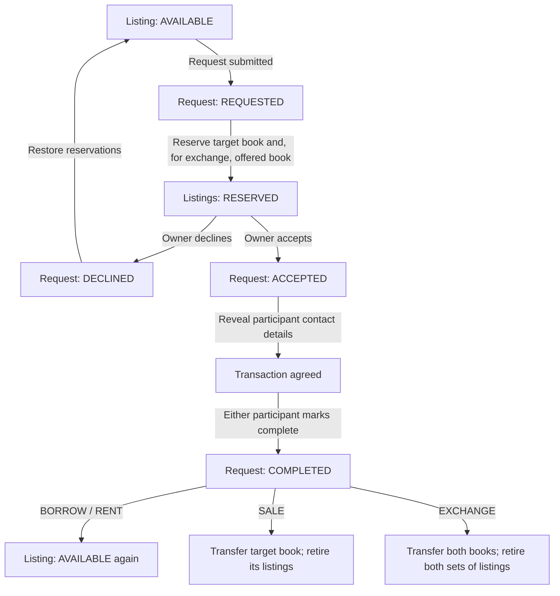

# BookLoop Lite

BookLoop Lite is a portfolio MVP for a peer-to-peer book circulation community. Members can add physical books to their personal shelves and publish listings that other members can request to borrow, rent, buy, or exchange.

The project demonstrates a full-stack application with authentication, book/listing management, transaction state transitions, resource reservation, and ownership updates. **Borrow and exchange have the most complete end-to-end workflows. Buy/sale and rent are currently workflow prototypes; they do not process payments.** See [MVP Scope and Known Limitations](#mvp-scope-and-known-limitations) for the exact feature status.

BookLoop Lite is a lightweight implementation separate from the planned enterprise BookLoop platform (Java, Spring Boot, PostgreSQL, Docker).

* **Web Application:** [https://bookloop-lite.vercel.app](https://bookloop-lite.vercel.app)
* **Backend API:** [https://bookloop-lite-backend.onrender.com](https://bookloop-lite-backend.onrender.com)

> **Note for Reviewers:** The backend runs on Render's free tier and may spin down after inactivity. If the initial login or registration request takes 30–50 seconds, the server may be waking up from a cold start; subsequent requests should respond faster. Demo credentials are listed below.

---

## System Architecture

The application uses a decoupled client-server architecture deployed across Vercel (frontend) and Render (backend), communicating through a REST API over HTTPS with cross-origin HTTP-only cookie authentication.

```mermaid
flowchart LR
    subgraph Client ["Frontend (Vercel)"]
        UI["React 18 + Vite SPA"]
        AuthCtx["AuthContext & Route Guards"]
        Axios["Axios Client (withCredentials)"]
        UI --> AuthCtx --> Axios
    end

    subgraph Server ["Backend API (Render)"]
        CORS["CORS & Reverse Proxy Middleware"]
        JWT["JWT Cookie Verification"]
        Domain["Domain Rules & Resource Locking"]
        CORS --> JWT --> Domain
    end

    subgraph Storage ["Persistence Layer"]
        LowDB[("lowdb (data.json)")]
    end

    Axios -- "HTTPS / JSON + HttpOnly Cookie" --> CORS
    Domain -- "Serialized Request Processing" --> LowDB
```



---

## Transaction & Locking Lifecycle

A request moves through a controlled lifecycle. Creating a request reserves the relevant listing resources so the same book cannot be committed to another pending transaction. An owner can accept or decline; either participant can mark an accepted transaction complete.



For **SALE** and **EXCHANGE**, completion updates book ownership and retires the relevant listings. For **BORROW** and **RENT**, completion currently makes the listing available again; BookLoop Lite does not track an actual loan/rental period or return.

---

## Core Functionality

* **Book and Listing Decoupling:** Separates physical inventory (`Books`) from market availability (`Listings`). A member adds a book to their personal shelf and can publish a transaction listing for that item.
* **Borrow:** A free temporary-loan workflow. It validates zero pricing, supports request/accept/decline/completion, reserves the listing while pending, and makes it available again when marked complete.
* **Exchange:** An end-to-end two-sided book swap. The requester must choose an eligible book from their own shelf. Both books are reserved while the request is pending; declining restores the listings, while completion transfers ownership in both directions and retires the old listings.
* **Buy / Sale (workflow prototype):** A member can publish a sale listing with a price, and another member can request it. The owner can accept or decline; marking an accepted sale complete transfers ownership to the requester and retires the listing. **No money is collected, payment is not verified, and no payment provider is integrated.** The completion action is a simulated workflow step.
* **Rent (workflow prototype):** A member can publish a rent listing with a fee and maximum duration, and another member can request it. The request workflow and listing reservation are present. **No rent payment is collected, the rental period is not enforced, and there is no dedicated return/overdue workflow.** Marking the request complete simply makes the listing available again.
* **Mutual Resource Locking:** Initiating a request locks the target listing. For exchanges, the backend also reserves every available listing associated with the offered physical book, preventing either book from being committed to another request at the same time.
* **Privacy-Gated Contact Disclosure:** Participant email addresses remain hidden during the `REQUESTED` phase and are revealed only after the owner accepts the request (`ACCEPTED`).

### Key Engineering Decisions

1. **Two-Sided Exchange Integrity:** An exchange request requires a valid `offeredBookId` owned by the requester. The backend checks ownership and locks the listings associated with both books. If a book has multiple listings, those listings are reserved together to prevent conflicting commitments.
2. **Cross-Origin Session Security:** Authentication tokens are issued as HTTP-only JWT cookies configured for secure cross-origin requests between the Vercel frontend and Render backend.
3. **Serialized Updates:** lowdb is a JSON-file datastore. Request-changing operations are serialized within the single backend process to avoid overlapping read-modify-write operations. This is a single-instance safeguard, not distributed database concurrency control.
4. **Demo Data Seeding:** A demo dataset is seeded when the datastore is empty. The persistence limitations of the hosting filesystem are described below.

---

## MVP Scope and Known Limitations

BookLoop Lite is a portfolio MVP, not a production marketplace handling real money, rental obligations, or physical delivery.

| Feature | Current status |
| :--- | :--- |
| User registration and login | Implemented |
| Personal book shelf and public listings | Implemented |
| Borrow request, approval, decline, reservation and completion | Implemented |
| Exchange request with offered-book selection, two-book reservation, decline restoration and ownership transfer | Implemented |
| Sale listing and request workflow | Implemented as a simulation; no payment |
| Sale completion and ownership transfer | Implemented; payment is not collected or verified |
| Rent listing and request workflow | Implemented as a prototype; no payment |
| Rental period enforcement, returns and overdue handling | Not implemented |
| Payment provider, checkout, refunds or payment verification | Not implemented |
| In-app notification badge / unread request counter | Not implemented |
| QR return verification, postal tracking, chat, automated email or push notifications | Not implemented |

**Persistence:** The current lowdb JSON file is suitable for a small demonstration, not durable production storage. Render's free filesystem may be reset when the service restarts or is redeployed. Do not use the app for important personal records; migrate to a managed database before relying on persistent user data.

**Session secret:** Configure a strong `JWT_SECRET` environment variable on the backend host. If it is omitted, a temporary random secret is generated and sessions will be invalidated when the server restarts.

**Concurrency:** Serialized request processing protects updates within this single Node.js process. It does not provide cross-instance locking or replace database transactions. A production deployment should use a managed database with transactional constraints/locking.

**Notifications:** A small badge showing the number of incoming requests that are still awaiting the owner's response would be a useful future UI enhancement. It is not currently implemented; it could initially be calculated from the existing incoming-requests endpoint without introducing real-time infrastructure.

---

## Automated Verification

Run the backend integration tests:

```bash
cd backend
npm ci
npm test
```

The integration suite starts an isolated API instance and verifies authentication protection, required and owned exchange offers, reservation of both books, restoration after decline, ownership transfer after exchange completion, borrow/rent completion behavior, sale ownership transfer, and invalid price rejection.

GitHub Actions runs the backend integration suite, frontend production build, and dependency security audits.

---

## Tech Stack

| Layer | Technology | Role |
| :--- | :--- | :--- |
| **Frontend** | React, Vite, React Router, Plain CSS | Single-page application with custom CSS design tokens and responsive layouts |
| **HTTP Client** | Axios | Centralized API client with automatic environment base-URL switching |
| **Backend** | Node.js, Express | REST API, business-rule enforcement, and resource locking |
| **Authentication** | JSON Web Tokens (`jsonwebtoken`), `bcryptjs`, `cookie-parser` | Password hashing and HTTP-only cookie sessions |
| **Database** | `lowdb` | Lightweight JSON document store with zero native dependencies |
| **Hosting** | Vercel (Frontend), Render (Backend) | Split-stack deployment |

---

## API Reference

### Authentication

| Method | Endpoint | Auth | Description |
| :--- | :--- | :--- | :--- |
| `POST` | `/api/auth/register` | Public | Create a new member account and issue session cookie |
| `POST` | `/api/auth/login` | Public | Authenticate credentials and issue session cookie |
| `POST` | `/api/auth/logout` | Public | Clear authentication cookie |
| `GET` | `/api/auth/me` | Required | Return the currently authenticated user profile |

### Books (Personal Shelf)

| Method | Endpoint | Auth | Description |
| :--- | :--- | :--- | :--- |
| `GET` | `/api/books/mine` | Required | List all physical books owned by the current user |
| `POST` | `/api/books` | Required | Add a new book to the user's shelf |
| `DELETE` | `/api/books/:id` | Required | Remove a book (blocked if tied to an active/reserved deal) |

### Listings (Public Catalogue)

| Method | Endpoint | Auth | Description |
| :--- | :--- | :--- | :--- |
| `GET` | `/api/listings` | Public | Query available listings (supports `?type=`, `?genre=`, `?q=`) |
| `GET` | `/api/listings/mine` | Required | List active and historical listings for the user's books |
| `POST` | `/api/listings` | Required | Publish a new listing for an owned book |
| `DELETE` | `/api/listings/:id` | Required | Remove an `AVAILABLE` listing |

### Requests (Transaction Lifecycle)

| Method | Endpoint | Auth | Description |
| :--- | :--- | :--- | :--- |
| `GET` | `/api/requests/incoming` | Required | Fetch requests targeting the user's books |
| `GET` | `/api/requests/outgoing` | Required | Fetch requests initiated by the user |
| `POST` | `/api/requests` | Required | Initiate a request and reserve involved book listings |
| `PATCH` | `/api/requests/:id/accept` | Required | Owner accepts request and reveals participant contact emails |
| `PATCH` | `/api/requests/:id/decline` | Required | Owner declines request and restores locked listings |
| `PATCH` | `/api/requests/:id/complete` | Required | Finalize the workflow; transfers ownership for sale/exchange |

---

## Local Development Setup

### Prerequisites

* Node.js (v18 or higher)
* npm

### 1. Start the Backend API

```bash
cd backend
npm install
npm start
```

The API server starts on `http://localhost:4000` and automatically generates `backend/data.json` with seeded demo data.

### 2. Start the Frontend Client

```bash
cd frontend
npm install
npm run dev
```

The Vite development server starts on `http://localhost:5173`.

### Demo Accounts

Three pre-seeded accounts are available to test multi-user exchange and request workflows:

| Name | Email | Password |
| :--- | :--- | :--- |
| Alice | `alice@bookloop.dev` | `password123` |
| Ben | `ben@bookloop.dev` | `password123` |
| Clara | `clara@bookloop.dev` | `password123` |

---

## Project Structure

```text
bookloop-lite/
├── backend/
│   ├── package.json
│   └── src/
│       ├── db.js                  # lowdb initialization and seed dataset
│       └── server.js              # Express routes, CORS/cookie config, locking engine
└── frontend/
    ├── index.html
    ├── package.json
    ├── vercel.json                # SPA fallback routing configuration for Vercel
    ├── vite.config.js
    └── src/
        ├── api.js                 # Axios instance with production/local base URL routing
        ├── AuthContext.jsx        # Global session state and auth persistence
        ├── App.jsx                # Protected route definitions
        ├── index.css              # Design tokens, typography, and layout styles
        ├── components/
        │   ├── AuthLayout.jsx     # Split-screen authentication wrapper
        │   ├── BookCard.jsx       # Catalogue listing card with transaction badges
        │   └── Navbar.jsx         # Navigation header and active route indicators
        └── pages/
            ├── LoginPage.jsx
            ├── RegisterPage.jsx
            ├── CataloguePage.jsx
            ├── ListingDetailPage.jsx  # Listing view with mandatory swap book picker
            ├── ShelfPage.jsx
            └── RequestsPage.jsx       # Incoming/outgoing transaction state management
```
